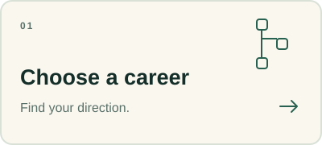
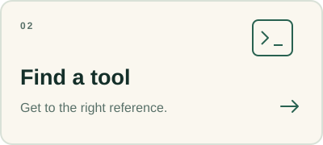
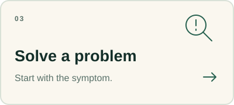

# Start Here

What do you want to do next? Choose a direction below, or [find your starting point](choose-your-starting-point.md) if you are unsure.

<table>
<tr>
<td width="33%"></td>
<td width="33%"></td>
<td width="33%"></td>
</tr>
</table>

[Choose a career](../02-career-paths/) · [Find a tool](../04-tools/) · [Solve a problem](../07-troubleshooting/)

## Take the route that fits

| You want to… | Start here |
| --- | --- |
| Work out what to learn first | [Choose your starting point](choose-your-starting-point.md) |
| Explore DevOps, SRE, cloud, or another role | [Career paths](../02-career-paths/) |
| Understand Linux, networking, containers, or another subject | [Engineering topics](../03-topics/) |
| Find references for a specific technology | [Tools](../04-tools/) |
| Learn within AWS, Azure, or Google Cloud | [Cloud platforms](../05-cloud-platforms/) |
| Practise through an exercise or project | [Practice](../06-practice/) |
| Investigate a failure | [Troubleshooting](../07-troubleshooting/) |
| Pick a book, course, or certification resource | [Learning library](../08-learning/) |

## Three useful places to begin

**[The Missing Semester →](https://missing.csail.mit.edu/)**  
Learn the command-line tools, version control, and debugging workflows that make everyday engineering work easier. Choose a lesson that addresses a task you struggle with.  
**Free online · Lectures and exercises · Basic programming familiarity helpful**

**[Pro Git →](https://git-scm.com/book/en/v2)**  
Understand version control through Git Basics, then return to branching and collaboration when your work needs them.  
**Free online · Book · Beginner onward**

**[Docker Get Started →](https://docs.docker.com/get-started/)**  
Choose an introductory application tutorial to connect an image, a running container, and the configuration around it.  
**Free documentation · Guided tutorials · Software and account requirements vary**

## Find what you need without reading everything

Use a career page to choose relevant subjects, a topic page to explore a subject, and a tool page for its implementation resources. If something is failing, enter through the symptom instead.

For a first learning session, choose one resource and one small outcome: explain a concept, reproduce an example, or answer a specific question. You can return for deeper material when the next task calls for it.

[Choose your starting point →](choose-your-starting-point.md) · [Back to the directory](../README.md)
