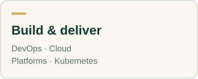
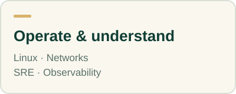
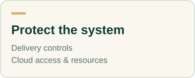

# Choose Your Engineering Direction

Choose the work you want to understand. Each path connects you to a few useful starting resources, relevant technologies, and a practical next step.

<table>
<tr>
<td width="33%"></td>
<td width="33%"></td>
<td width="33%"></td>
</tr>
</table>

[Build and deliver](#build-and-deliver) · [Operate and understand](#operate-and-understand) · [Protect the system](#protect-the-system)

## Build and deliver

| You want to… | Explore |
| --- | --- |
| Automate the path from code to a usable service | [DevOps engineering →](devops.md) |
| Provide supported capabilities for other developers | [Platform engineering →](platform-engineering.md) |
| Build and operate workloads in a cloud provider | [Cloud engineering →](cloud-engineering.md) |
| Work with application orchestration | [Kubernetes engineering →](kubernetes-engineering.md) |

## Operate and understand

| You want to… | Explore |
| --- | --- |
| Improve reliability and reduce recurring operational work | [SRE →](sre.md) |
| Understand hosts, services, processes, and permissions | [Linux and systems →](linux-systems.md) |
| Investigate requests through their signals | [Observability →](observability.md) |
| Build and troubleshoot connectivity | [Network engineering →](network-engineering.md) |

## Protect the system

| You want to… | Explore |
| --- | --- |
| Integrate security into software delivery | [DevSecOps →](devsecops.md) |
| Protect cloud access, data, and resources | [Cloud security →](cloud-security.md) |

## Two paths look similar?

| Compare | The useful distinction |
| --- | --- |
| DevOps and platform engineering | Follow an individual delivery path in DevOps; support a reusable capability for other teams in platform engineering. |
| SRE and observability | Use SRE for reliability objectives and operating decisions; use observability for instrumentation and investigation. |
| DevSecOps and cloud security | Follow source-to-runtime trust boundaries in DevSecOps; focus on provider identities, resources, and data in cloud security. |

Job titles vary between organizations. Use the responsibilities in a job description to choose your resources.

## Not sure which path fits?

Start with [your current knowledge and goal](../01-start-here/choose-your-starting-point.md). Choose one small task you would like to complete, then follow the resources that help you do it. The paths overlap; you can move between them as your work changes.

[Back to the directory](../README.md)
