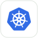

# Kubernetes Engineering

If you can already run and explain a containerized application, use this page to find resources for orchestration, workload configuration, and cluster troubleshooting. Otherwise, begin with [Docker](https://docs.docker.com/get-started/).

<table>
<tr>
<td align="center"><a href="https://kubernetes.io/docs/concepts/overview/"> Kubernetes</a></td>
<td align="center"><a href="https://helm.sh/docs/"> Helm</a></td>
<td align="center"><a href="https://argo-cd.readthedocs.io/en/stable/getting_started/"> Argo CD</a></td>
</tr>
</table>

## Choose the reference for your task

**[Learn Kubernetes Basics →](https://kubernetes.io/docs/tutorials/kubernetes-basics/)**  
Follow the introductory route through deploying, exposing, scaling, and updating an application.  
**Free tutorials · Foundation · Check the exercise environment**

**[Kubernetes concepts →](https://kubernetes.io/docs/concepts/overview/)**  
Build the model behind the objects and controllers you use; follow the concept relevant to your workload.  
**Free documentation · Foundation to intermediate**

**[Troubleshooting applications →](https://kubernetes.io/docs/tasks/debug/debug-application/)**  
Select the diagnostic guide matching a failing workload or application boundary.  
**Free documentation · Intermediate · Appropriate cluster access required**

Use documentation matching your cluster release. Public documentation does not imply free cluster infrastructure.

## Connect the surrounding knowledge

[Containers](https://docs.docker.com/get-started/) · [Networking](network-engineering.md) · [Security](devsecops.md) · [Observability](observability.md)

Use [Helm](https://helm.sh/docs/) for packaging resources and [Argo CD](https://argo-cd.readthedocs.io/en/stable/getting_started/) when your task involves Git-controlled reconciliation. Learn the workload model before adding either.

## Take a workload through a change

Follow [Kubernetes Basics](https://kubernetes.io/docs/tutorials/kubernetes-basics/): deploy, expose, scale, and update the sample application. Check the tutorial’s cluster prerequisites and use the documentation version matching your environment. Reading is free; a hosted cluster can cost money.

Keep the workload definition and evidence of a request before and after an update. Next, make a reversible mistake in the sample workload and use the [application troubleshooting guides](https://kubernetes.io/docs/tasks/debug/debug-application/) to explain events, status, and traffic behavior.

Delete the disposable cluster and inspect any separately created load balancers, volumes, registry artifacts, and credentials. Your result should explain the controller’s behavior, rather than merely show a successful command.

Continue to [platform engineering](platform-engineering.md) for shared developer capabilities or [SRE](sre.md) for service objectives and operating decisions.

[All career paths](README.md) · [Directory homepage](../README.md)
