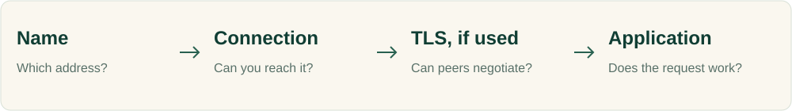

# Network Engineering

Follow the request from its source. A name resolving, a connection opening, and an application returning a useful response are different observations.

## Learn the layer you need

**[Cloudflare: What is DNS? →](https://www.cloudflare.com/learning/dns/what-is-dns/)**  
Understand resolvers, authoritative servers, caching, and the lookup process.  
**Free · Concept guide · Beginner**

**[Wireshark User’s Guide →](https://www.wireshark.org/docs/wsug_html_chunked/)**  
Use the capture and analysis sections to learn how to inspect authorized traffic.  
**Free documentation · Intermediate · Capture permissions may be required**

**[Beej’s Guide to Network Programming →](https://beej.us/guide/bgnet/)**  
Study sockets and client/server communication through programming examples.  
**Free online · Guide · C programming familiarity needed**

## Connect the subject to your environment

| Your environment | Useful collection |
| --- | --- |
| Hosts, processes, and network listeners | [Linux and systems](linux-systems.md) |
| Cloud subnets, routing, and access | [Cloud platforms](../05-cloud-platforms/) |
| Container and cluster traffic | [Containers](../03-topics/containers.md) · [Kubernetes](../03-topics/kubernetes.md) |
| Failed lookups or connections | [Network troubleshooting](../07-troubleshooting/networking.md) |

## Make a failing path understandable

Use two owned local workloads or VMs. Record source, destination, name resolution, connection behavior, and a functional request. Change one reversible setting and compare observations from the failing and healthy paths. Capture only traffic you are authorized to inspect; remove sensitive payloads and restore the lab configuration afterward.

[Networking topics →](../03-topics/networking.md) · [Find labs →](../06-practice/labs.md)

Use [observability](observability.md) when you need to connect request behavior to service signals, or [cloud security](cloud-security.md) when access policy is the central question.

[All career paths](README.md) · [Directory homepage](../README.md)
