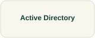

# Active Directory

Start with forests, domains, controllers, and identities before choosing an administration recipe.

## Start with these

**[Active Directory Domain Services learning path →](https://learn.microsoft.com/en-us/training/paths/active-directory-domain-services/)**  
Use the fundamentals and management modules with their listed prerequisites.  
**Free documentation · Exercise setup and permissions vary**

[Source and project material](https://github.com/MicrosoftDocs/windowsserverdocs)

## Watch and understand

[Microsoft Learn Shows →](https://learn.microsoft.com/en-us/shows/)  
**Broader teaching or talk catalog**

## Longer reading

[Learn PowerShell in a Month of Lunches, Fourth Edition →](https://www.manning.com/books/learn-powershell-in-a-month-of-lunches) · **Paid book; publisher samples**

**PowerShell learning**

## Try a small task

Model a small isolated learning domain and explain one account and group access relationship.

**Keep:** A redacted directory diagram and a verified permitted-versus-denied operation.

**Setup:** isolated learning VM or domain with appropriate licenses and privileges. **Cleanup:** test identities, guests, snapshots, and configuration changes.

**Related discoveries:** [Windows Server](windows-server.md) · [PowerShell](powershell.md)

[Browse this collection](README.md) · [Directory homepage](../README.md)
