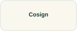

# Cosign

Keep the artifact identity and verification expectation explicit when exploring signing.

## Start with these

**[Cosign documentation →](https://docs.sigstore.dev/cosign/)**  
Choose the signing and verification workflow matching your identity environment.  
**Free documentation · Exercise setup and permissions vary**

[Source and project material](https://github.com/sigstore/cosign)

## Community and further learning

**[Sigstore community →](https://www.sigstore.dev/community/)**  
Find community discussions and recordings across the Sigstore ecosystem.  
**Publisher or project catalog · Check individual session access**
## Longer reading

[Security Engineering →](https://www.cl.cam.ac.uk/archive/rja14/book.html) · **Author-hosted material; edition access varies**

**Security-design background**

## Try a small task

Sign an owned learning artifact through a supported workflow and verify the expected identity or key.

**Keep:** The artifact digest and verification criteria, without private material.

**Setup:** owned artifacts and authorized test environments. **Cleanup:** vulnerable learning applications, temporary credentials, and integrations.

**Related discoveries:** [Syft](syft.md) · [GitHub Actions](github-actions.md)

[Browse this collection](README.md) · [Directory homepage](../README.md)
