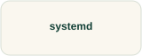

# systemd

Learn to read a unit and its observed state together.

## References to keep open

**[systemd for administrators →](https://systemd.io/)**  
Follow the administrator material linked by the project.  
**Free documentation · Exercise setup and permissions vary**

[Source and project material](https://github.com/systemd/systemd)

## Watch the workflow

**[systemd video linked from the guide →](https://www.youtube.com/watch?v=_rrpjYD373A)**  
**Video · Check the recording’s date and environment**

## Worth exploring

**[SadServers →](https://sadservers.com/)**  
Investigate a broken system and explain the evidence behind your fix.  
**Free trials and paid plans**

## Longer reading

[The Linux Command Line →](https://linuxcommand.org/tlcl.php) · **Free PDF; paid print editions**

## Try a small task

Write a small learning service and a timer in a disposable VM, then inspect their logs.

**Keep:** The unit files and the timing evidence for an execution.

**Setup:** synthetic files or a disposable host for administrative changes. **Cleanup:** altered settings, test accounts, keys, and learning VMs.

**Related discoveries:** [Linux](linux.md) · [Bash](bash.md)

[Browse this collection](README.md) · [Directory homepage](../README.md)
