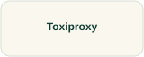

# Toxiproxy

Use a controlled network fault to examine how a small application handles a dependency problem.

## Start with these

**[Toxiproxy examples →](https://github.com/Shopify/toxiproxy)**  
Read the client examples and proxy lifecycle in the project README.  
**Free documentation · Exercise setup and permissions vary**

[Source and project material](https://github.com/Shopify/toxiproxy)

## Watch and understand

[FOSDEM video archive →](https://video.fosdem.org/)  
**Broader teaching or talk catalog**

## Longer reading

[The Site Reliability Workbook →](https://sre.google/workbook/table-of-contents/) · **Free online book**

**Operating decisions and service objectives**

## Try a small task

Introduce a short bounded delay between two owned learning services and then remove it.

**Keep:** The proxy settings and application behavior before, during, and after the delay.

**Setup:** owned target, bounded load or fault, explicit stop condition. **Cleanup:** stop generators, undo faults, and verify recovery.

**Related discoveries:** [k6](k6.md) · [OpenTelemetry](opentelemetry.md)

[Browse this collection](README.md) · [Directory homepage](../README.md)
