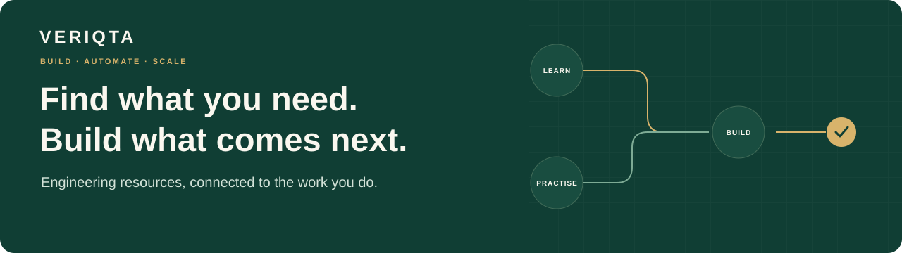
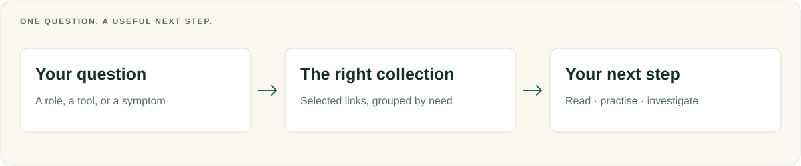

  

# VERIQTA Engineering Resource Directory

Find your next useful resource in DevOps, cloud, SRE, platform engineering, Linux, and infrastructure. Start with what you want to learn, the technology you use, or the problem you need to solve.

<table>
<tr>
<td width="33%"></td>
<td width="33%"></td>
<td width="33%"></td>
</tr>
</table>

[Choose a career](careers/) · [Find a tool](tools/) · [Solve a problem](troubleshooting/)

## Where do you want to go?

| Your next step | Open the collection |
| --- | --- |
| Find a starting point | [Start here →](start-here/) |
| Explore a role or change direction | [Career paths →](careers/) |
| Understand a subject | [Engineering topics →](topics/) |
| Work with a technology | [Tools →](tools/) |
| Focus on a cloud provider | [Cloud platforms →](cloud/) |
| Build something or test your skills | [Labs, projects, and practice →](practice/) |
| Investigate a failure | [Troubleshooting →](troubleshooting/) |
| Choose a book, course, or certification resource | [Learning library →](learning/) |

## Pick your direction

[**DevOps**](careers/devops.md) · [**SRE**](careers/sre.md) · [**Platform Engineering**](careers/platform-engineering.md) · [**Cloud Engineering**](careers/cloud-engineering.md)

[Linux & Systems](careers/linux-systems.md) · [Kubernetes Engineering](careers/kubernetes-engineering.md) · [DevSecOps](careers/devsecops.md) · [Cloud Security](careers/cloud-security.md) · [Observability](careers/observability.md) · [Network Engineering](careers/network-engineering.md)

## Find your technology

Choose a logo or name to open its resource page.

<table>
<tr>
<td align="center" width="25%"><a href="tools/git.md"> <strong>Git</strong></a></td>
<td align="center" width="25%"><a href="tools/docker.md"> <strong>Docker</strong></a></td>
<td align="center" width="25%"><a href="tools/kubernetes.md"> <strong>Kubernetes</strong></a></td>
<td align="center" width="25%"><a href="tools/terraform.md"> <strong>Terraform</strong></a></td>
</tr>
<tr>
<td align="center" width="25%"><a href="tools/opentofu.md"> <strong>OpenTofu</strong></a></td>
<td align="center" width="25%"><a href="tools/ansible.md"> <strong>Ansible</strong></a></td>
<td align="center" width="25%"><a href="tools/github-actions.md"> <strong>GitHub Actions</strong></a></td>
<td align="center" width="25%"><a href="tools/jenkins.md"> <strong>Jenkins</strong></a></td>
</tr>
<tr>
<td align="center" width="25%"><a href="tools/helm.md"> <strong>Helm</strong></a></td>
<td align="center" width="25%"><a href="tools/argo-cd.md"> <strong>Argo CD</strong></a></td>
<td align="center" width="25%"><a href="tools/prometheus.md"> <strong>Prometheus</strong></a></td>
<td align="center" width="25%"><a href="tools/grafana.md"> <strong>Grafana</strong></a></td>
</tr>
<tr>
<td align="center" width="25%"><a href="tools/opentelemetry.md"> <strong>OpenTelemetry</strong></a></td>
<td align="center" colspan="3"><a href="tools/"><strong>Explore the tool directory →</strong></a> Documentation, tutorials, practice, and troubleshooting</td>
</tr>
</table>

## Follow the subject

| Foundations | Build and deliver | Operate and protect |
| --- | --- | --- |
| [Linux](topics/linux.md) | [Containers](topics/containers.md) | [Observability](topics/observability.md) |
| [Networking](topics/networking.md) | [Kubernetes](topics/kubernetes.md) | [Reliability](topics/reliability.md) |
| [Scripting](topics/scripting.md) | [Infrastructure as Code](topics/infrastructure-as-code.md) | [Security](topics/security.md) |
| [Databases](topics/databases.md) | [CI/CD](topics/cicd.md) · [GitOps](topics/gitops.md) | [Troubleshooting](troubleshooting/) |

## Work in your cloud

[**AWS →**](cloud/aws.md) &nbsp; [**Microsoft Azure →**](cloud/azure.md) &nbsp; [**Google Cloud →**](cloud/google-cloud.md)

## Start with the problem

| What you are facing | Where to look |
| --- | --- |
| A service will not start, or a host is under pressure | [Linux troubleshooting](troubleshooting/linux.md) |
| A name resolves, but the connection fails | [Networking troubleshooting](troubleshooting/networking.md) |
| A container exits or behaves differently | [Container troubleshooting](troubleshooting/containers.md) |
| A Pod keeps restarting or traffic cannot reach it | [Kubernetes troubleshooting](troubleshooting/kubernetes.md) |
| A pipeline fails or a release does not behave as expected | [Pipeline troubleshooting](troubleshooting/pipelines.md) |
| Cloud access, connectivity, or resources fail | [Cloud troubleshooting](troubleshooting/cloud.md) |
| Queries slow down, connections grow, or replication falls behind | [Database troubleshooting](troubleshooting/databases.md) |

## Put it into practice

[**Labs**](practice/labs.md) for a focused skill · [**Projects**](practice/projects.md) for a complete result · [**Playgrounds**](practice/playgrounds.md) for exploration · [**Challenges**](practice/challenges.md) to test your reasoning

## Keep learning

[Books](learning/books.md) · [Courses](learning/courses.md) · [Certification resources](learning/certifications.md) · [Engineering blogs](learning/engineering-blogs.md)

Choose a resource that fits your question and current knowledge. Check prerequisites, access conditions, and the version you use. You do not need to learn every tool or follow every career path.

## Help make the directory better

Found a broken link or a resource worth including? [Open an issue](https://github.com/VERIQTA-WORLD/veriqta-engineering-resource-directory/issues) with the page, link, and a short explanation of what would help you.

---

**VERIQTA · Build • Automate • Scale**  
[Explore VERIQTA WORLD](https://github.com/VERIQTA-WORLD) · [Visual assets](assets/)

Tool names and logos belong to their respective owners. Inclusion does not imply affiliation or endorsement. [Icon sources](assets/logos/SOURCES.md).
