

# VERIQTA Discovery

Discover places to learn DevOps, cloud, SRE, networking, systems administration, and platform engineering. Find teaching websites, YouTube channels, individual talks, books, labs, and explanations worth keeping.

[Start here](01-start-here/) · [Browse by career](02-career-paths/) · [Explore topics](03-engineering-topics/) · [Find practice](06-hands-on-practice/) · [Discover learning libraries](08-learning-libraries/)

## Choose how you want to explore

| Collection | What you can discover |
| --- | --- |
| [**01 · Start here**](01-start-here/) | Choose a route from your interests and experience |
| [**02 · Career paths**](02-career-paths/) | Find resource directions for the work you want to do |
| [**03 · Engineering topics**](03-engineering-topics/) | Follow Linux, networking, reliability, security, and other subjects |
| [**04 · Tools and technologies**](04-tools-and-technologies/) | Browse tools across delivery, cloud, SRE, networks, systems, and platforms |
| [**05 · Cloud platforms**](05-cloud-platforms/) | Find provider learning and service-specific directions |
| [**06 · Hands-on practice**](06-hands-on-practice/) | Explore browser environments, troubleshooting challenges, and exercises |
| [**07 · Engineering in the wild**](07-engineering-in-the-wild/) | Find incidents, technical talks, architecture stories, and engineering blogs |
| [**08 · Learning libraries**](08-learning-libraries/) | Discover teachers, books, course websites, and learning platforms |

## Tools and technologies

Choose a logo or name to open the publisher’s documentation, learning page, or project reference. These source links work independently of the discovery collections being assembled. Documentation access does not include a product subscription, hosted lab, or infrastructure.

**Looking for more than documentation? [Explore Wireshark discoveries →](04-tools-and-technologies/wireshark.md)** Browse teaching resources, packet captures, a book, and specific conference sessions together.

<table>
<caption>Tools and technologies: select a logo or name to open its source</caption>
<tr><th colspan="4" align="left">Source and delivery</th></tr>
<tr><td align="center" width="25%"><a href="https://git-scm.com/book/en/v2"> <strong>Git</strong></a></td><td align="center" width="25%"><a href="https://docs.github.com/en/actions"> <strong>GitHub Actions</strong></a></td><td align="center" width="25%"><a href="https://docs.gitlab.com/ci/"> <strong>GitLab CI/CD</strong></a></td><td align="center" width="25%"><a href="https://www.jenkins.io/doc/"> <strong>Jenkins</strong></a></td></tr>
<tr><td align="center" width="25%"><a href="https://tekton.dev/docs/"> <strong>Tekton</strong></a></td><td align="center" width="25%"><a href="https://circleci.com/docs/"> <strong>CircleCI</strong></a></td><td align="center" width="25%"><a href="https://buildkite.com/docs"> <strong>Buildkite</strong></a></td><td></td></tr>
<tr><th colspan="4" align="left">Containers</th></tr>
<tr><td align="center" width="25%"><a href="https://docs.docker.com/get-started/"> <strong>Docker</strong></a></td><td align="center" width="25%"><a href="https://podman.io/docs"> <strong>Podman</strong></a></td><td align="center" width="25%"><a href="https://containerd.io/docs/"> <strong>containerd</strong></a></td><td align="center" width="25%"><a href="https://buildah.io/"> <strong>Buildah</strong></a></td></tr>
<tr><th colspan="4" align="left">Orchestration and GitOps</th></tr>
<tr><td align="center" width="25%"><a href="https://kubernetes.io/docs/home/"> <strong>Kubernetes</strong></a></td><td align="center" width="25%"><a href="https://helm.sh/docs/"> <strong>Helm</strong></a></td><td align="center" width="25%"><a href="https://argo-cd.readthedocs.io/en/stable/"> <strong>Argo CD</strong></a></td><td align="center" width="25%"><a href="https://fluxcd.io/flux/"> <strong>Flux</strong></a></td></tr>
<tr><td align="center" width="25%"><a href="https://kubectl.docs.kubernetes.io/references/kustomize/">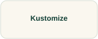 <strong>Kustomize</strong></a></td><td align="center" width="25%"><a href="https://kind.sigs.k8s.io/docs/user/quick-start/"> <strong>kind</strong></a></td><td align="center" width="25%"><a href="https://minikube.sigs.k8s.io/docs/"> <strong>minikube</strong></a></td><td align="center" width="25%"><a href="https://k9scli.io/"> <strong>K9s</strong></a></td></tr>
<tr><td align="center" width="25%"><a href="https://docs.redhat.com/en/products/openshift_container_platform"> <strong>OpenShift</strong></a></td><td align="center" width="25%"><a href="https://developer.hashicorp.com/nomad/docs"> <strong>Nomad</strong></a></td><td align="center" width="25%"><a href="https://ranchermanager.docs.rancher.com/"> <strong>Rancher</strong></a></td><td></td></tr>
<tr><th colspan="4" align="left">Infrastructure and configuration</th></tr>
<tr><td align="center" width="25%"><a href="https://developer.hashicorp.com/terraform/tutorials"> <strong>Terraform</strong></a></td><td align="center" width="25%"><a href="https://opentofu.org/docs/"> <strong>OpenTofu</strong></a></td><td align="center" width="25%"><a href="https://www.pulumi.com/docs/"> <strong>Pulumi</strong></a></td><td align="center" width="25%"><a href="https://docs.ansible.com/projects/ansible/latest/getting_started/index.html"> <strong>Ansible</strong></a></td></tr>
<tr><td align="center" width="25%"><a href="https://docs.chef.io/"> <strong>Chef</strong></a></td><td align="center" width="25%"><a href="https://help.puppet.com/"> <strong>Puppet</strong></a></td><td align="center" width="25%"><a href="https://docs.saltproject.io/en/latest/"> <strong>Salt</strong></a></td><td align="center" width="25%"><a href="https://developer.hashicorp.com/packer/docs"> <strong>Packer</strong></a></td></tr>
<tr><td align="center" width="25%"><a href="https://developer.hashicorp.com/vagrant/docs"> <strong>Vagrant</strong></a></td><td align="center" width="25%"><a href="https://docs.crossplane.io/"> <strong>Crossplane</strong></a></td><td></td><td></td></tr>
<tr><th colspan="4" align="left">Systems and scripting</th></tr>
<tr><td align="center" width="25%"><a href="https://docs.kernel.org/"> <strong>Linux</strong></a></td><td align="center" width="25%"><a href="https://documentation.ubuntu.com/"> <strong>Ubuntu</strong></a></td><td align="center" width="25%"><a href="https://www.debian.org/doc/"> <strong>Debian</strong></a></td><td align="center" width="25%"><a href="https://docs.rockylinux.org/"> <strong>Rocky Linux</strong></a></td></tr>
<tr><td align="center" width="25%"><a href="https://wiki.almalinux.org/"> <strong>AlmaLinux</strong></a></td><td align="center" width="25%"><a href="https://docs.alpinelinux.org/user-handbook/0.1a/index.html"> <strong>Alpine Linux</strong></a></td><td align="center" width="25%"><a href="https://docs.freebsd.org/en/books/handbook/"> <strong>FreeBSD</strong></a></td><td align="center" width="25%"><a href="https://systemd.io/"> <strong>systemd</strong></a></td></tr>
<tr><td align="center" width="25%"><a href="https://www.gnu.org/software/bash/manual/"> <strong>Bash</strong></a></td><td align="center" width="25%"><a href="https://learn.microsoft.com/en-us/powershell/"> <strong>PowerShell</strong></a></td><td align="center" width="25%"><a href="https://docs.python.org/3/tutorial/"> <strong>Python</strong></a></td><td align="center" width="25%"><a href="https://go.dev/learn/"> <strong>Go</strong></a></td></tr>
<tr><td align="center" width="25%"><a href="https://www.openssh.com/manual.html"> <strong>OpenSSH</strong></a></td><td align="center" width="25%"><a href="https://github.com/tmux/tmux/wiki"> <strong>tmux</strong></a></td><td align="center" width="25%"><a href="https://neovim.io/doc/"> <strong>Neovim</strong></a></td><td></td></tr>
<tr><th colspan="4" align="left">Metrics and monitoring</th></tr>
<tr><td align="center" width="25%"><a href="https://prometheus.io/docs/introduction/overview/"> <strong>Prometheus</strong></a></td><td align="center" width="25%"><a href="https://grafana.com/docs/grafana/latest/"> <strong>Grafana</strong></a></td><td align="center" width="25%"><a href="https://thanos.io/tip/thanos/getting-started.md/"> <strong>Thanos</strong></a></td><td align="center" width="25%"><a href="https://docs.victoriametrics.com/"> <strong>VictoriaMetrics</strong></a></td></tr>
<tr><td align="center" width="25%"><a href="https://www.zabbix.com/documentation/current/en/manual">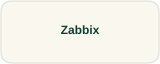 <strong>Zabbix</strong></a></td><td align="center" width="25%"><a href="https://www.nagios.org/documentation/"> <strong>Nagios</strong></a></td><td align="center" width="25%"><a href="https://icinga.com/docs/"> <strong>Icinga</strong></a></td><td align="center" width="25%"><a href="https://learn.netdata.cloud/"> <strong>Netdata</strong></a></td></tr>
<tr><td align="center" width="25%"><a href="https://docs.datadoghq.com/"> <strong>Datadog</strong></a></td><td align="center" width="25%"><a href="https://docs.newrelic.com/"> <strong>New Relic</strong></a></td><td align="center" width="25%"><a href="https://prometheus.io/docs/alerting/latest/alertmanager/"> <strong>Alertmanager</strong></a></td><td></td></tr>
<tr><th colspan="4" align="left">Logs and tracing</th></tr>
<tr><td align="center" width="25%"><a href="https://opentelemetry.io/docs/"> <strong>OpenTelemetry</strong></a></td><td align="center" width="25%"><a href="https://www.jaegertracing.io/docs/"> <strong>Jaeger</strong></a></td><td align="center" width="25%"><a href="https://zipkin.io/"> <strong>Zipkin</strong></a></td><td align="center" width="25%"><a href="https://grafana.com/docs/loki/latest/"> <strong>Grafana Loki</strong></a></td></tr>
<tr><td align="center" width="25%"><a href="https://grafana.com/docs/tempo/latest/"> <strong>Grafana Tempo</strong></a></td><td align="center" width="25%"><a href="https://www.elastic.co/docs/reference/elasticsearch"> <strong>Elasticsearch</strong></a></td><td align="center" width="25%"><a href="https://www.elastic.co/docs/explore-analyze"> <strong>Kibana</strong></a></td><td align="center" width="25%"><a href="https://docs.fluentbit.io/manual"> <strong>Fluent Bit</strong></a></td></tr>
<tr><th colspan="4" align="left">Packet analysis and diagnostics</th></tr>
<tr><td align="center" width="25%"><a href="https://www.wireshark.org/learn.html"> <strong>Wireshark</strong></a></td><td align="center" width="25%"><a href="https://www.tcpdump.org/manpages/tcpdump.1.html"> <strong>tcpdump</strong></a></td><td align="center" width="25%"><a href="https://github.com/nmap/nmap"> <strong>Nmap</strong></a></td><td align="center" width="25%"><a href="https://everything.curl.dev/"> <strong>curl</strong></a></td></tr>
<tr><td align="center" width="25%"><a href="https://man7.org/linux/man-pages/man8/ip.8.html">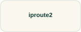 <strong>iproute2</strong></a></td><td></td><td></td><td></td></tr>
<tr><th colspan="4" align="left">DNS and traffic</th></tr>
<tr><td align="center" width="25%"><a href="https://bind9.readthedocs.io/en/latest/"> <strong>BIND 9</strong></a></td><td align="center" width="25%"><a href="https://coredns.io/manual/toc/"> <strong>CoreDNS</strong></a></td><td align="center" width="25%"><a href="https://nginx.org/en/docs/"> <strong>NGINX</strong></a></td><td align="center" width="25%"><a href="https://www.haproxy.org/#docs"> <strong>HAProxy</strong></a></td></tr>
<tr><td align="center" width="25%"><a href="https://www.envoyproxy.io/docs/envoy/latest/"> <strong>Envoy</strong></a></td><td align="center" width="25%"><a href="https://doc.traefik.io/traefik/"> <strong>Traefik</strong></a></td><td align="center" width="25%"><a href="https://caddyserver.com/docs/"> <strong>Caddy</strong></a></td><td></td></tr>
<tr><th colspan="4" align="left">Networking and connectivity</th></tr>
<tr><td align="center" width="25%"><a href="https://docs.cilium.io/en/stable/"> <strong>Cilium</strong></a></td><td align="center" width="25%"><a href="https://docs.tigera.io/calico/latest/about/"> <strong>Calico</strong></a></td><td align="center" width="25%"><a href="https://docs.frrouting.org/en/latest/"> <strong>FRRouting</strong></a></td><td align="center" width="25%"><a href="https://www.wireguard.com/quickstart/"> <strong>WireGuard</strong></a></td></tr>
<tr><td align="center" width="25%"><a href="https://openvpn.net/community-docs/"> <strong>OpenVPN</strong></a></td><td></td><td></td><td></td></tr>
<tr><th colspan="4" align="left">Secrets and policy</th></tr>
<tr><td align="center" width="25%"><a href="https://developer.hashicorp.com/vault/docs"> <strong>Vault</strong></a></td><td align="center" width="25%"><a href="https://openbao.org/docs/"> <strong>OpenBao</strong></a></td><td align="center" width="25%"><a href="https://www.openpolicyagent.org/docs"> <strong>Open Policy Agent</strong></a></td><td align="center" width="25%"><a href="https://kyverno.io/docs/"> <strong>Kyverno</strong></a></td></tr>
<tr><td align="center" width="25%"><a href="https://cert-manager.io/docs/"> <strong>cert-manager</strong></a></td><td></td><td></td><td></td></tr>
<tr><th colspan="4" align="left">Supply chain and runtime security</th></tr>
<tr><td align="center" width="25%"><a href="https://trivy.dev/latest/docs/"> <strong>Trivy</strong></a></td><td align="center" width="25%"><a href="https://oss.anchore.com/docs/guides/vulnerability/"> <strong>Grype</strong></a></td><td align="center" width="25%"><a href="https://oss.anchore.com/docs/guides/sbom/"> <strong>Syft</strong></a></td><td align="center" width="25%"><a href="https://falco.org/docs/"> <strong>Falco</strong></a></td></tr>
<tr><td align="center" width="25%"><a href="https://www.checkov.io/1.Welcome/Quick%20Start.html"> <strong>Checkov</strong></a></td><td align="center" width="25%"><a href="https://semgrep.dev/docs/"> <strong>Semgrep</strong></a></td><td align="center" width="25%"><a href="https://docs.sonarsource.com/sonarqube-server/"> <strong>SonarQube</strong></a></td><td align="center" width="25%"><a href="https://www.zaproxy.org/docs/"> <strong>ZAP</strong></a></td></tr>
<tr><td align="center" width="25%"><a href="https://docs.snyk.io/"> <strong>Snyk</strong></a></td><td align="center" width="25%"><a href="https://goharbor.io/docs/"> <strong>Harbor</strong></a></td><td align="center" width="25%"><a href="https://docs.sigstore.dev/cosign/"> <strong>Cosign</strong></a></td><td></td></tr>
<tr><th colspan="4" align="left">Databases and messaging</th></tr>
<tr><td align="center" width="25%"><a href="https://www.postgresql.org/docs/current/tutorial.html"> <strong>PostgreSQL</strong></a></td><td align="center" width="25%"><a href="https://dev.mysql.com/doc/"> <strong>MySQL</strong></a></td><td align="center" width="25%"><a href="https://redis.io/docs/latest/"> <strong>Redis</strong></a></td><td align="center" width="25%"><a href="https://valkey.io/topics/"> <strong>Valkey</strong></a></td></tr>
<tr><td align="center" width="25%"><a href="https://www.mongodb.com/docs/"> <strong>MongoDB</strong></a></td><td align="center" width="25%"><a href="https://kafka.apache.org/documentation/"> <strong>Apache Kafka</strong></a></td><td align="center" width="25%"><a href="https://www.rabbitmq.com/docs"> <strong>RabbitMQ</strong></a></td><td align="center" width="25%"><a href="https://etcd.io/docs/"> <strong>etcd</strong></a></td></tr>
<tr><th colspan="4" align="left">Storage and recovery</th></tr>
<tr><td align="center" width="25%"><a href="https://docs.ceph.com/en/latest/"> <strong>Ceph</strong></a></td><td align="center" width="25%"><a href="https://docs.min.io/aistor/"> <strong>MinIO</strong></a></td><td align="center" width="25%"><a href="https://velero.io/docs/"> <strong>Velero</strong></a></td><td align="center" width="25%"><a href="https://restic.readthedocs.io/en/stable/"> <strong>restic</strong></a></td></tr>
<tr><th colspan="4" align="left">Virtualization and private cloud</th></tr>
<tr><td align="center" width="25%"><a href="https://pve.proxmox.com/pve-docs/"> <strong>Proxmox VE</strong></a></td><td align="center" width="25%"><a href="https://www.qemu.org/documentation/"> <strong>QEMU</strong></a></td><td align="center" width="25%"><a href="https://linux-kvm.org/page/Documents"> <strong>KVM</strong></a></td><td align="center" width="25%"><a href="https://libvirt.org/docs.html"> <strong>libvirt</strong></a></td></tr>
<tr><td align="center" width="25%"><a href="https://docs.openstack.org/"> <strong>OpenStack</strong></a></td><td></td><td></td><td></td></tr>
<tr><th colspan="4" align="left">Performance and failure testing</th></tr>
<tr><td align="center" width="25%"><a href="https://grafana.com/docs/k6/latest/"> <strong>k6</strong></a></td><td align="center" width="25%"><a href="https://docs.locust.io/en/stable/">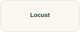 <strong>Locust</strong></a></td><td align="center" width="25%"><a href="https://jmeter.apache.org/usermanual/index.html"> <strong>Apache JMeter</strong></a></td><td align="center" width="25%"><a href="https://chaos-mesh.org/docs/">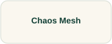 <strong>Chaos Mesh</strong></a></td></tr>
<tr><td align="center" width="25%"><a href="https://docs.litmuschaos.io/">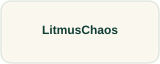 <strong>LitmusChaos</strong></a></td><td align="center" width="25%"><a href="https://github.com/Shopify/toxiproxy"> <strong>Toxiproxy</strong></a></td><td></td><td></td></tr>
<tr><th colspan="4" align="left">Developer platforms</th></tr>
<tr><td align="center" width="25%"><a href="https://backstage.io/docs/"> <strong>Backstage</strong></a></td><td></td><td></td><td></td></tr>
<tr><th colspan="4" align="left">Cloud command lines and templates</th></tr>
<tr><td align="center" width="25%"><a href="https://docs.aws.amazon.com/cli/latest/userguide/">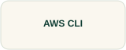 <strong>AWS CLI</strong></a></td><td align="center" width="25%"><a href="https://learn.microsoft.com/en-us/cli/azure/">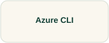 <strong>Azure CLI</strong></a></td><td align="center" width="25%"><a href="https://docs.cloud.google.com/sdk/docs"> <strong>gcloud CLI</strong></a></td><td align="center" width="25%"><a href="https://docs.aws.amazon.com/cloudformation/">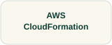 <strong>AWS CloudFormation</strong></a></td></tr>
<tr><td align="center" width="25%"><a href="https://learn.microsoft.com/en-us/azure/azure-resource-manager/bicep/"> <strong>Bicep</strong></a></td><td align="center" width="25%"><a href="https://terragrunt.gruntwork.io/docs/">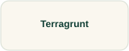 <strong>Terragrunt</strong></a></td><td></td><td></td></tr>
<tr><th colspan="4" align="left">Windows administration</th></tr>
<tr><td align="center" width="25%"><a href="https://learn.microsoft.com/en-us/windows-server/">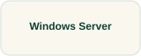 <strong>Windows Server</strong></a></td><td align="center" width="25%"><a href="https://learn.microsoft.com/en-us/training/paths/active-directory-domain-services/"> <strong>Active Directory</strong></a></td><td align="center" width="25%"><a href="https://learn.microsoft.com/en-us/windows-server/virtualization/hyper-v/"> <strong>Hyper-V</strong></a></td><td></td></tr>
<tr><th colspan="4" align="left">Network platforms and inventory</th></tr>
<tr><td align="center" width="25%"><a href="https://www.cisco.com/c/en/us/products/ios-nx-os-software/ios-xe/index.html"> <strong>Cisco IOS XE</strong></a></td><td align="center" width="25%"><a href="https://www.juniper.net/documentation/product/us/en/junos-os/"> <strong>Junos OS</strong></a></td><td align="center" width="25%"><a href="https://help.mikrotik.com/docs/"> <strong>MikroTik RouterOS</strong></a></td><td align="center" width="25%"><a href="https://docs.netgate.com/pfsense/en/latest/"> <strong>pfSense</strong></a></td></tr>
<tr><td align="center" width="25%"><a href="https://docs.opnsense.org/"> <strong>OPNsense</strong></a></td><td align="center" width="25%"><a href="https://netboxlabs.com/docs/netbox/"> <strong>NetBox</strong></a></td><td></td><td></td></tr>
<tr><th colspan="4" align="left">Service connectivity</th></tr>
<tr><td align="center" width="25%"><a href="https://istio.io/latest/docs/"> <strong>Istio</strong></a></td><td align="center" width="25%"><a href="https://linkerd.io/2/overview/"> <strong>Linkerd</strong></a></td><td></td><td></td></tr>
</table>

## Find something beyond the manual

| You are looking for… | Open |
| --- | --- |
| Packet-analysis teachers and conference case studies | [Wireshark discoveries](04-tools-and-technologies/wireshark.md) |
| Somewhere to practise troubleshooting | [Hands-on practice](06-hands-on-practice/) |
| What engineers learned from real failures | [Engineering in the wild](07-engineering-in-the-wild/) |
| A learning website or book you can return to | [Learning libraries](08-learning-libraries/) |

## Help someone discover a worthwhile resource

Found a clear explanation, an overlooked talk, or a useful lab? [Suggest it](CONTRIBUTING.md) with a direct link and a sentence explaining its value.

[Complete file map](FILE-MAP.md) · [Writing and curation standard](WRITING-STANDARD.md) · [Graphic attribution](assets/ATTRIBUTION.md)
